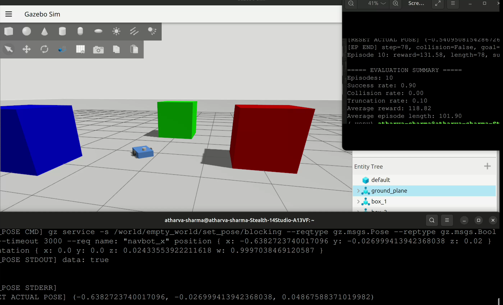
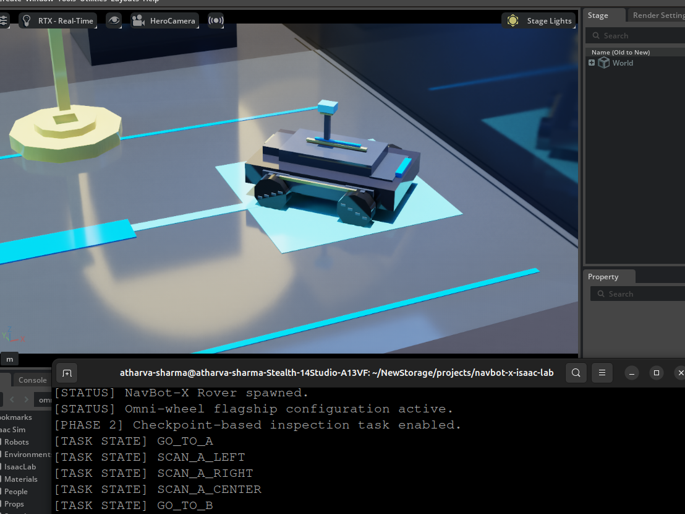
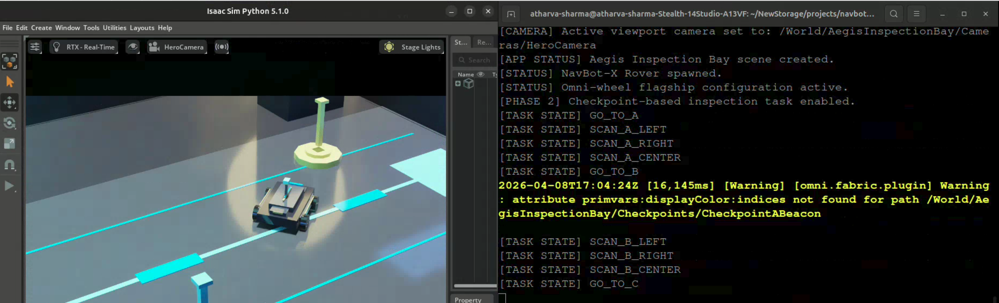
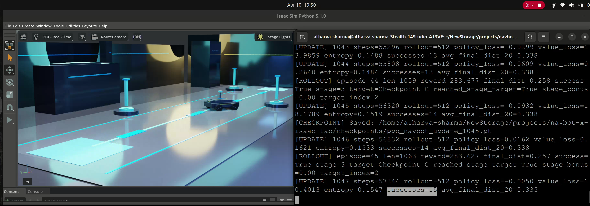

# NavBot-X Isaac Lab  
### Sequential Checkpoint Navigation with PPO + Human Gesture Override in Aegis Inspection Bay

NavBot-X Isaac Lab is a flagship robotics simulation project built around **autonomous rover navigation**, **reinforcement learning**, and **human-in-the-loop control** inside a premium futuristic industrial environment called **Aegis Inspection Bay**.

This project is the next-generation continuation of an earlier Gazebo-based navigation system, now rebuilt in an **Isaac Sim / Isaac Lab / Omniverse-oriented stack** to support better simulation quality, stronger project identity, and a more advanced Physical AI portfolio direction.

---

## Project Purpose

The purpose of NavBot-X Isaac Lab is to build a compact autonomous inspection rover that can operate in two control modes:

1. **Self-controlled mode** using Reinforcement Learning  
2. **Human-guided mode** using gesture-based control

This dual capability is what makes the project unique.

The rover is designed to perform structured indoor inspection-style navigation tasks across multiple checkpoints in a futuristic industrial environment. It can learn to make movement decisions by itself through PPO-based RL, while also supporting human override / human-directed behavior through gesture input.

---

## Core Uniqueness

What makes NavBot-X Isaac Lab unique is its **hybrid intelligence model**:

- **Autonomous control** through Reinforcement Learning
- **Human control** through gesture-based command input
- **Premium simulator-side environment design** instead of a bare utility scene
- **Checkpoint mission progression** rather than only one-point navigation
- **Physical AI direction** combining perception-inspired design, embodied movement, route logic, and simulation-driven control

This project is not just “a robot moving in simulation.”  
It explores a more meaningful robotics idea:

> a rover that can act **on its own** or be guided **by a human**, depending on the task and control mode.

---

## Why This Project Is Useful

NavBot-X Isaac Lab is useful as a prototype for:

- industrial inspection robotics
- indoor route monitoring
- autonomous checkpoint traversal
- human-in-the-loop robotic supervision
- simulation-first robotics development
- RL policy learning in structured environments
- future Physical AI systems that combine autonomy and human intervention

This kind of architecture is relevant for environments where a robot should usually work independently, but still allow a person to guide or override it when needed.

Examples:
- factory inspection bays
- warehouse patrol systems
- industrial monitoring zones
- robotics testing environments
- future smart facility agents

---

## Project Evolution

This repo represents the progression from an earlier Gazebo foundation into a more advanced Isaac-based robotics simulation stack.

### Foundation Phase — Gazebo / ROS2 Base
The earlier project established the navigation and RL idea in a Gazebo-based setup.



### Phase 1 — Aegis Inspection Bay Visual Foundation
The first Isaac phase focused on scene building, rover identity, cameras, cinematic route presentation, and premium environment design.

#### Hero View


#### Route View


### Phase 2 — Structured Checkpoint Task Logic
Phase 2 introduced checkpoint progression, task sequencing, and more meaningful inspection mission behavior.



### Phase 3 — Reinforcement Learning Navigation
Phase 3 focused on PPO-based RL training for sequential checkpoint traversal.



### Phase 3B — Gesture-Based Human Control
Alongside autonomous behavior, gesture input was explored as a human-guided control mode.


---

## Final Milestone Achieved

At the end of this milestone, NavBot-X achieved:

- autonomous sequential checkpoint traversal using PPO
- successful multi-stage route learning in Isaac Sim
- stable mission progression across checkpoints
- dual-control project identity:
  - **RL-based autonomous mode**
  - **gesture-based human control mode**

This project is now being frozen as a **completed milestone release** before future extensions.

---

## Technical Stack

- **Ubuntu 24.04**
- **Isaac Sim**
- **Isaac Lab**
- **Python**
- **PyTorch**
- **PPO (Proximal Policy Optimization)**
- **NumPy**
- **Omniverse / USD scene construction**
- **Custom rover controller**
- **Gesture input pipeline (separate control path)**

---

## Rover Overview

NavBot-X is a compact inspection rover with a modular structure consisting of:

- **Main Chassis**
- **Upper Equipment Deck**
- **Front Sensor Module**
- **Central Sensor Mast**
- **Sensor Head / Perception Pod**
- **Wheel Drive Modules**
- **Undercarriage Mobility Frame**
- **Signature Tech Accent Elements**

The rover is visually designed as a premium futuristic inspection platform and functionally structured as a checkpoint-navigation agent.

---

## RL Task Summary

The reinforcement learning task evolved in stages:

- single checkpoint navigation
- A → B sequential navigation
- A → B → C sequential navigation

The policy learns to map normalized navigation observations to rover actions:
- forward motion
- yaw / turning control

The training loop uses PPO with:
- policy network
- value network
- rollout collection
- GAE / returns
- minibatch PPO updates
- checkpoint saving and training continuation

---

## Control Modes

### 1. Autonomous RL Mode
The rover learns to move toward checkpoints by maximizing reward through trial and error.

### 2. Gesture Control Mode
The rover can also be controlled through a human command pipeline, giving the project a human-in-the-loop control dimension.

This combination is the strongest identity feature of the project.

---

## Repository Structure

```
navbot-x-isaac-lab/
├── README.md
├── LICENSE
├── .gitignore
├── pyproject.toml
├── setup.py
│
├── assets/
├── config/
├── docs/
├── experiments/
│
├── logs/
│   └── .gitkeep
├── checkpoints/
│   └── .gitkeep
│
├── media/
│   ├── images/
│   │   ├── foundationphase.png
│   │   ├── hero.png
│   │   ├── route.png
│   │   ├── phasetwo.png
│   │   ├── RL.png
│   │   └── gesture.png
│   ├── videos/
│   │   └── .gitkeep
│   ├── renders/
│   │   └── .gitkeep
│   └── demo_clips/
│       └── .gitkeep
│
├── scripts/
│   └── run_aegis_app.py
│
├── tools/
│   ├── gesture_writer.py
│   ├── ppo_train_navbot.py
│   ├── rl_env_sanity_check.py
│   └── rl_train_stub.py
│
├── source/
│   └── navbot_x_isaac_lab/
│       ├── __init__.py
│       ├── utils/
│       │   ├── __init__.py
│       │   └── paths.py
│       │
│       ├── apps/
│       │   ├── __init__.py
│       │   └── aegis_app.py
│       │
│       ├── demo/
│       │   ├── __init__.py
│       │   ├── aegis_scene_builder.py
│       │   ├── checkpoint_manager.py
│       │   ├── gesture_controller.py
│       │   ├── gesture_input.py
│       │   ├── inspection_mission.py
│       │   ├── inspection_task.py
│       │   ├── layout_blueprint.py
│       │   ├── route_animator.py
│       │   ├── rover_controller.py
│       │   ├── scene_config.py
│       │   └── status_visualizer.py
│       │
│       ├── robots/
│       │   ├── __init__.py
│       │   └── mobile_base/
│       │
│       └── tasks/
│           ├── __init__.py
│           └── navigation/
│               ├── __init__.py
│               ├── navigation_env.py
│               ├── navigation_env_cfg.py
│               ├── inspection_rl_env.py
│               ├── inspection_rl_env_cfg.py
│               └── agents/
```

## License

Copyright (c) 2026 Atharva Sharma. All rights reserved.

This repository is shared for portfolio and demonstration purposes only.
No part of this project may be copied, redistributed, modified, or used commercially without explicit written permission from the author.