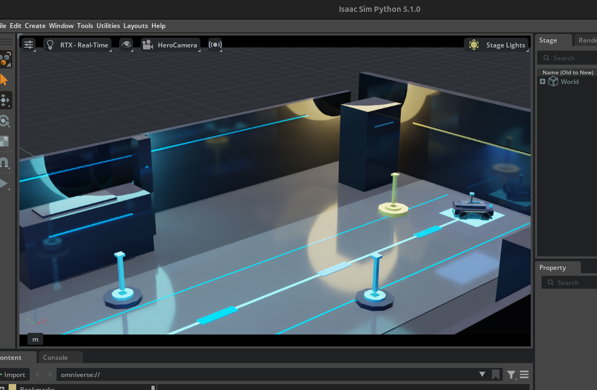
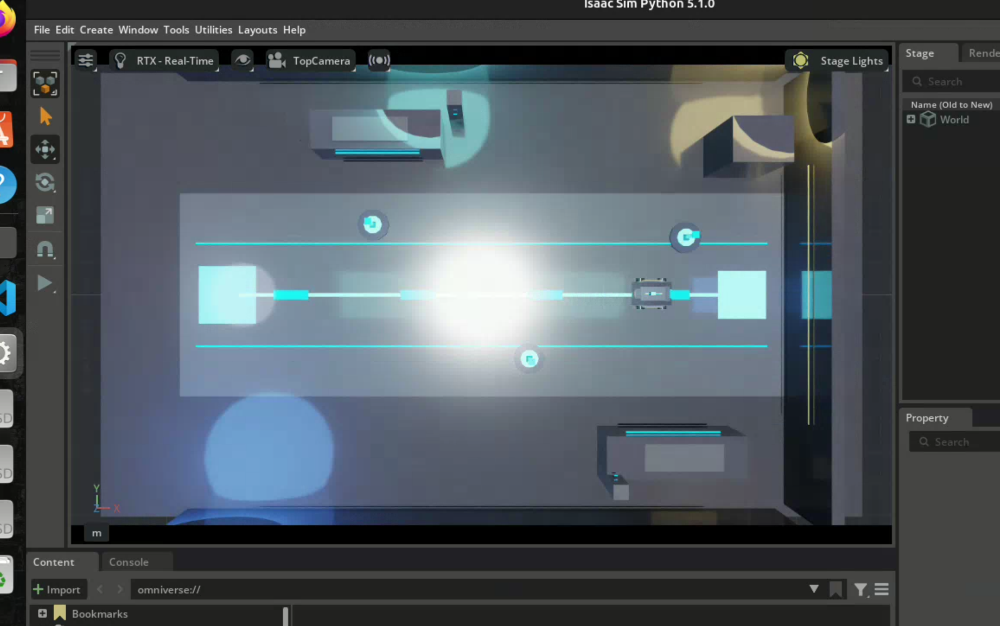
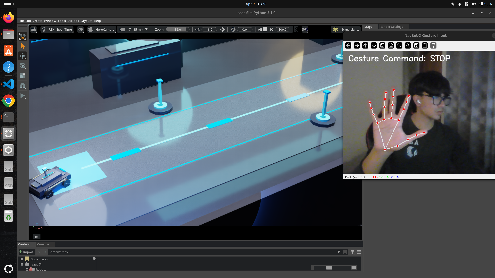

# NavBot-X Isaac Lab

A flagship robotics simulation project built in Isaac Sim / Isaac Lab around a premium autonomous inspection rover, cinematic environment design, structured inspection behavior, and future reinforcement learning plus gesture-control expansion.

---

## Project Identity

- **Project:** NavBot-X Isaac Lab
- **Scene:** Aegis Inspection Bay
- **Vehicle:** NavBot-X Rover
- **Mission:** Inspection Route Alpha

---

## Project Preview

### Hero Camera View


### Route Camera View


### Top View


### Gesture Control Demo


---

## Overview

NavBot-X Isaac Lab is the next-phase continuation of my robotics reinforcement learning journey, moving beyond my earlier Gazebo-based navigation work into a more advanced Isaac Sim, Isaac Lab, Physical AI, and premium simulation direction.

This project is intentionally built as a flagship portfolio project from the start, with emphasis on:

- premium black, blue, and gold visual identity
- cinematic environment presentation
- custom rover concept design
- structured inspection behavior
- future reinforcement learning integration
- gesture-control expansion

---

## Core Features

### Phase 1
- Aegis Inspection Bay simulator scene
- cinematic camera system
- premium colored lighting rig
- flagship NavBot-X Rover concept
- omnidirectional / mecanum-style wheel design
- scripted cinematic route demo

### Phase 2
- checkpoint-based inspection task
- task state machine
- rover controller abstraction
- checkpoint status visualization
- checkpoint-specific scan behavior
- structured simulator-side behavior foundation for RL

### Gesture Control Direction
- separate gesture pipeline from Isaac runtime
- webcam-based hand input
- MediaPipe-based gesture recognition
- command mapping for:
  - `FORWARD`
  - `BACKWARD`
  - `LEFT`
  - `RIGHT`
  - `STOP`

---

## Repository Structure

```text
navbot-x-isaac-lab/
├── README.md
├── .gitignore
├── LICENSE
├── pyproject.toml
├── setup.py
├── config/
│   └── extension.toml
├── source/
│   └── navbot_x_isaac_lab/
│       ├── __init__.py
│       ├── apps/
│       │   └── aegis_app.py
│       ├── demo/
│       │   ├── aegis_scene_builder.py
│       │   ├── checkpoint_manager.py
│       │   ├── gesture_controller.py
│       │   ├── gesture_input.py
│       │   ├── inspection_mission.py
│       │   ├── inspection_task.py
│       │   ├── layout_blueprint.py
│       │   ├── rover_controller.py
│       │   ├── route_animator.py
│       │   ├── scene_config.py
│       │   └── status_visualizer.py
│       ├── robots/
│       ├── tasks/
│       └── utils/
├── scripts/
│   ├── run_aegis_app.py
│   ├── play.py
│   ├── sanity_check.py
│   └── train.py
├── tools/
│   └── gesture_writer.py
├── docs/
│   └── architecture/
├── assets/
├── media/
│   ├── images/
│   ├── videos/
│   ├── renders/
│   └── demo_clips/
├── logs/
├── checkpoints/
└── experiments/
```