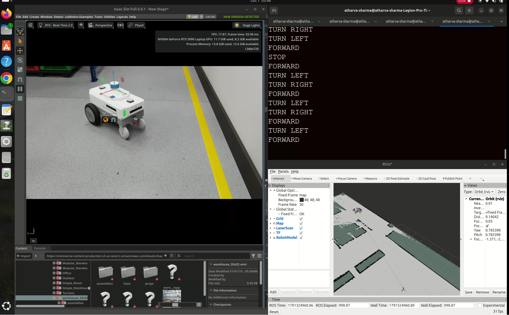
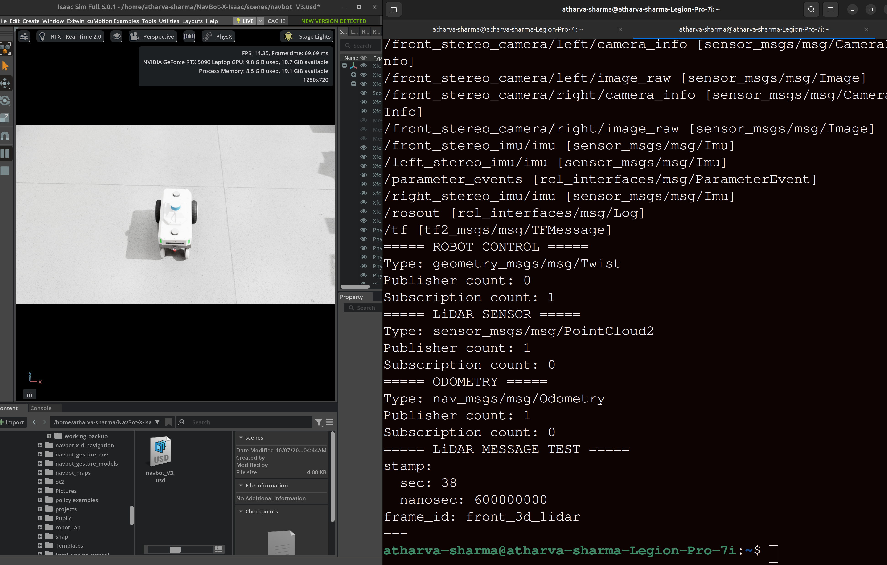
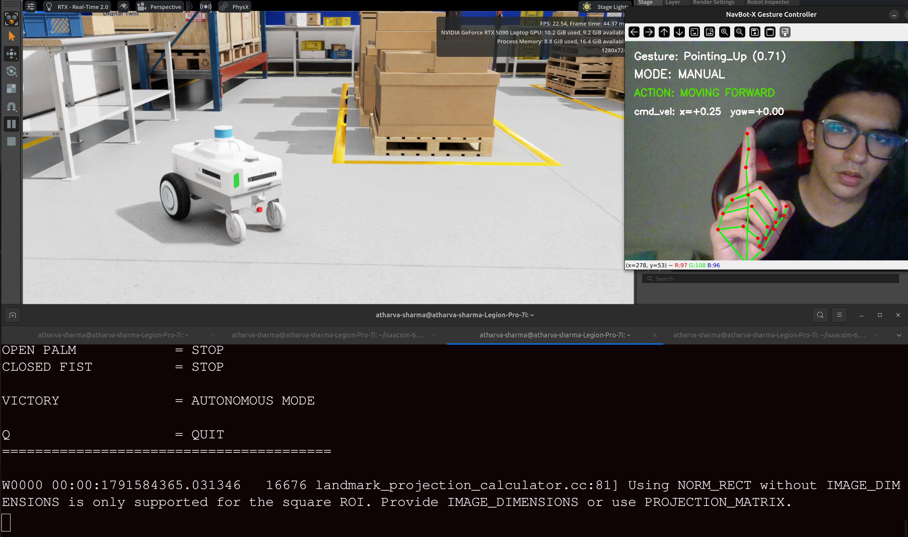
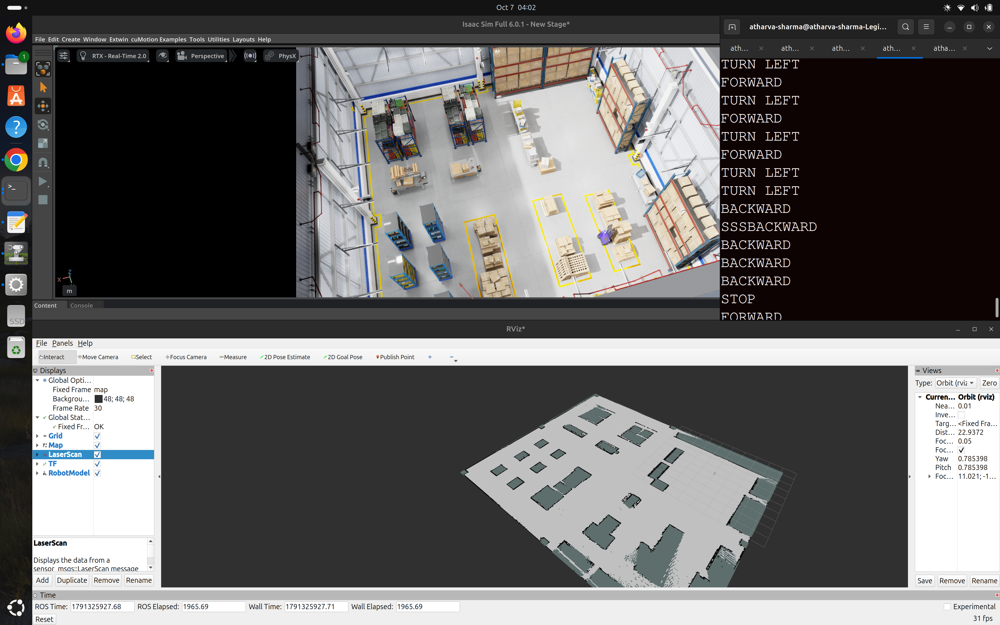
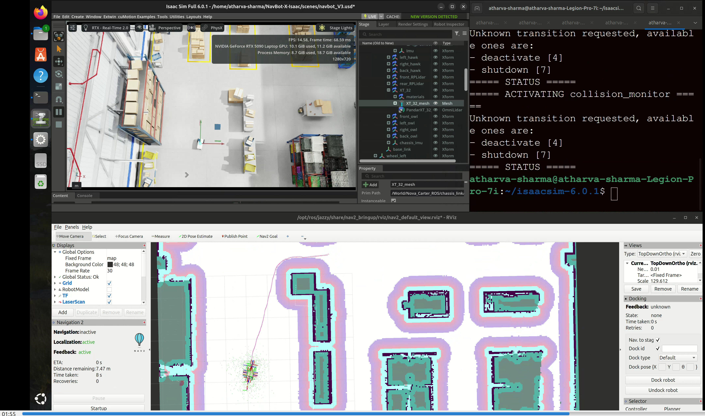
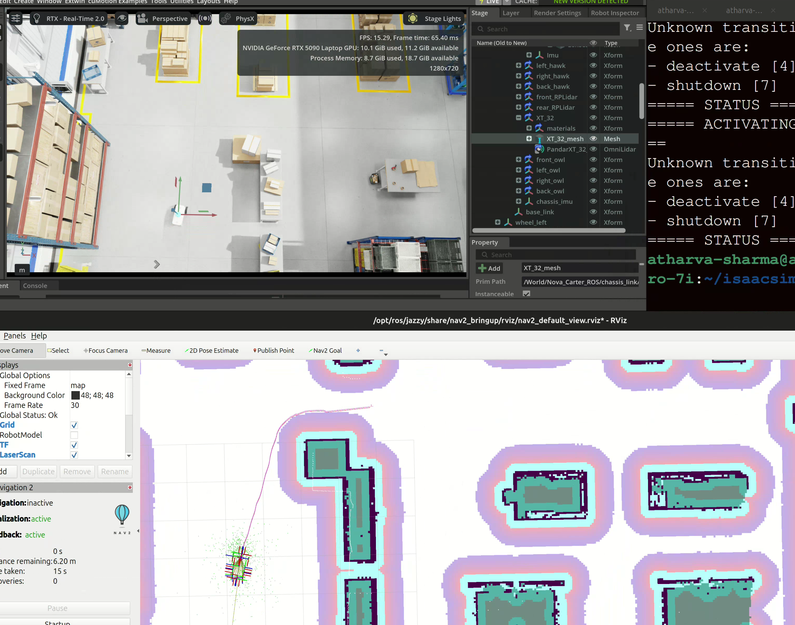
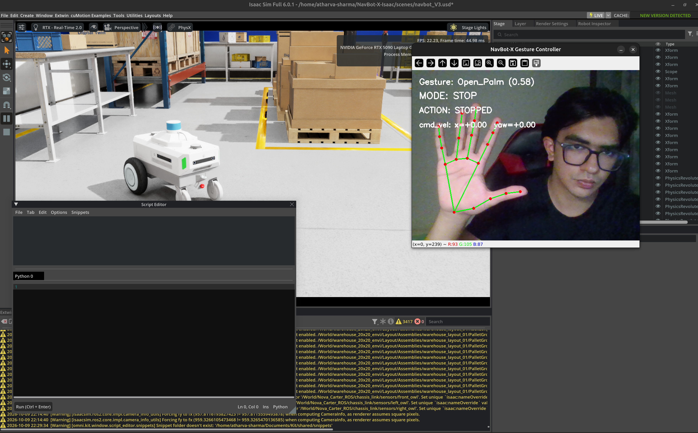

# NavBot-X — Autonomous Inspection Robot

**Multi-generation autonomous robotics project | Gazebo → NVIDIA Isaac Lab → NVIDIA Isaac Sim 6.0.1**

NavBot-X is a simulation-first autonomous inspection rover project exploring **robot navigation, custom reinforcement-learning policies, 3D LiDAR perception, and gesture-based human control**. The latest implementation uses **NVIDIA Nova Carter**, **ROS 2 Jazzy**, **SLAM Toolbox**, **Nav2**, and **MediaPipe** inside Isaac Sim 6.0.1.

> **Project status:** V3 has demonstrated manual driving, LiDAR mapping, AMCL localization, autonomous point-to-point Nav2 navigation, and gesture-command testing in simulation. A fresh-machine, end-to-end reproduction is **not yet independently validated**. Earlier versions used custom-trained PPO navigation policies; those policies are not claimed to run in V3.

## Project evolution

| Generation | Platform | Main achievement |
|---|---|---|
| **V1 — Foundation** | Gazebo + ROS 2 | Original inspection rover and custom PPO navigation experiments |
| **V2 — Aegis Inspection Bay** | Isaac Sim + Isaac Lab | Custom-built inspection environment, sequential checkpoints, and custom-trained PPO navigation |
| **V3 — Nova Carter** *(latest)* | Isaac Sim 6.0.1 + ROS 2 Jazzy | LiDAR SLAM, AMCL localization, Nav2 autonomous navigation, and gesture command switching |

## V3 — Nova Carter autonomous inspection

### 1. Robot and warehouse simulation



**Milestone:** Nova Carter is loaded in an NVIDIA Isaac Sim 6.0.1 warehouse scene. The scene references NVIDIA-hosted assets instead of storing large third-party model files in this repository.

### 2. ROS 2 communication



**Milestone:** The simulator exposes velocity control, odometry, clock and LiDAR topics, including `/cmd_vel`, `/chassis/odom`, `/clock` and `/front_3d_lidar/lidar_points`.

### 3. Manual robot control



**Milestone:** `geometry_msgs/msg/Twist` velocity commands move the simulated rover forward and turn it through ROS 2.

### 4. LiDAR-based SLAM mapping



**Milestone:** A 3D LiDAR point cloud is converted to a 2D `/scan` topic. SLAM Toolbox generates the warehouse occupancy map, which is saved under [`v3-nova/maps/`](v3-nova/maps/).

### 5. Autonomous path planning



**Milestone:** With a saved map and AMCL localization, Nav2 plans a route to a goal selected in RViz.

### 6. Autonomous goal reached



**Milestone:** Point-to-point autonomous navigation has been demonstrated in the simulated warehouse.

### 7. Gesture-based human control



**Milestone:** MediaPipe interprets gestures and publishes manual commands to `/cmd_vel_gesture`. ROS 2 `twist_mux` prioritizes gesture commands over autonomous commands. Gesture recognition and the command-priority path were tested; further full-system integration testing is planned.

| Gesture | Behavior |
|---|---|
| **Pointing Up** — center / left / right | Drive forward / turn left / turn right |
| **Thumb Down** | Reverse (`linear.x` negative) |
| **Open Palm / Closed Fist** | STOP |
| **Victory** | Release gesture control to AUTO / Nav2 |

## V3 system architecture

```text
         Isaac Sim 6.0.1 — Nova Carter + warehouse
                        │
            ROS 2 bridge / sensor topics
                 ┌──────┴────────┐
                 │               │
             LiDAR/odom     Camera → MediaPipe
                 │               │
     PointCloud2 → /scan     /cmd_vel_gesture
                 │               │
       SLAM map + AMCL           │ (high priority)
                 │               │
              Nav2 ── /cmd_vel_auto
                 │               │
                 └────┬──────────┘
                      ▼
                   twist_mux
                      │
                   /cmd_vel
                      │
                Nova Carter drive
```

**Important:** ROS 2 is the simulator-to-navigation/control interface. V3 uses **Nav2 for goal navigation**, not an RL policy on Nova Carter. The RL work remains documented in V1 and V2.

## Quick start

1. Install Ubuntu 24.04, Isaac Sim **6.0.1**, and ROS 2 **Jazzy** on a compatible NVIDIA system.
2. Clone this repository.
3. Follow the detailed [`V3 setup and launch guide`](v3-nova/README.md) to install ROS packages, load the USD scene, run LiDAR conversion, Nav2, and gesture control.
4. Open RViz, set the initial pose, choose a navigation goal, and validate command switching.

**External asset note:** The V3 USD file references NVIDIA-hosted Nova Carter and warehouse assets. Internet access and continued availability of those assets are required unless they are cached locally.

## V3 repository layout

```text
v3-nova/
├── scenes/navbot_V3.usd           # Isaac Sim scene
├── config/navbot_nav2.yaml       # ROS 2 Nav2 settings
├── config/navbot_twist_mux.yaml  # Autonomous/gesture priorities
├── maps/                          # Occupancy grid (.pgm + .yaml)
├── scripts/                       # Gesture recognition and manual-driving code
├── models/                        # Model downloaded locally, excluded from Git
├── setup/download_gesture_model.sh
└── README.md                      # Detailed setup + run instructions
```

## V2 — Aegis Inspection Bay: custom PPO checkpoint navigation

The second generation moved NavBot-X from Gazebo into **NVIDIA Isaac Sim / Isaac Lab**. It introduced an inspection-bay scene, sequential checkpoint logic, a custom-trained PPO navigation controller, and an early gesture-input workflow.

**Environment and route**


**Sequential checkpoint mission**


**Custom PPO navigation**


**Early human-in-the-loop gesture input**


The V2 task progressed from a single checkpoint to multi-stage **A → B → C** navigation. Its training work used PPO with policy/value networks, rollout collection, advantage estimation, and checkpoint saving.

The original in-depth V2 project description is preserved in [`README_LEGACY.md`](README_LEGACY.md). The corresponding code remains in the original `source/`, `config/`, `scripts/` and `tools/` directories.

## V1 — Gazebo foundation


NavBot-X began as a **Gazebo / ROS 2** inspection-rover prototype with custom PPO navigation work. V2 advanced the learning task in Isaac Lab; V3 extended the project toward a more complete ROS 2 autonomous navigation stack.

## Tools and technologies

**Simulation:** NVIDIA Isaac Sim 6.0.1, Isaac Lab, Gazebo, USD  
**Robotics:** ROS 2 Jazzy, Nav2, AMCL, SLAM Toolbox, RViz2, `twist_mux`  
**Perception and control:** LiDAR, `pointcloud_to_laserscan`, OpenCV, MediaPipe  
**Reinforcement learning (earlier versions):** Python, PyTorch, custom PPO

## What's next

- Validate the documented V3 setup on a second compatible machine.
- Test more complex gesture override, recovery, and Nav2 interactions.
- Evaluate integrating a **custom-trained** navigation policy into the latest Nova Carter stack.
- Investigate eventual deployment to a physical inspection robot.

## License

See [`LICENSE`](LICENSE) for repository licensing terms.
